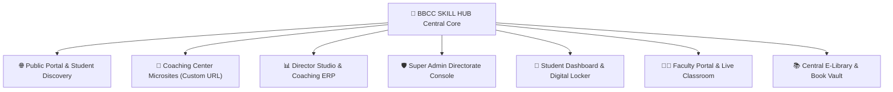
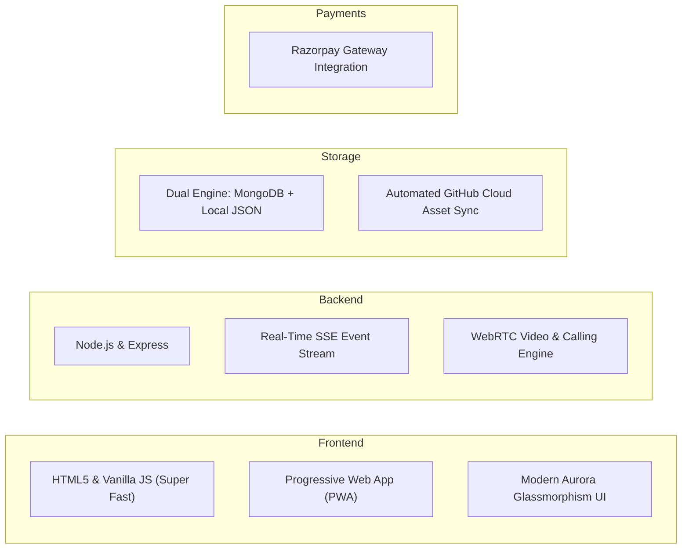

# 🚀 BBCC SKILL HUB — Complete Project Presentation Plan & Feature Guide
> **Digital Skill, Coaching Institute Network & Multi-Tenant Educational ERP Platform**  
> *Official Presentation Blueprint for Clients, Coaching Center Directors, Students & Educational Partners*

---

## 📌 Executive Summary (प्रोजेक्ट परिचय)

**BBCC SKILL HUB** (Bal Bharti Coaching Center Digital Platform) ek cutting-edge, all-in-one educational ecosystem aur multi-tenant coaching management network hai. 

Yeh platform Bharat ke coaching institutes, tuition centers aur digital teachers ko **apni branded digital identity banane, admissions badhane, live classes lene, digital study notes bechne, aur poore institute ko 100% digitally manage karne** ki poori aazadi deta hai.

---

## 💎 Core Value Proposition (Customer ko kyon pasand aayega?)

| Customer Profile | Unki Samasya (Problem) | BBCC SKILL HUB Ka Solution |
| :--- | :--- | :--- |
| **Coaching Center Director** | Website aur app banane me lakho ka kharch, admission records register me maintain karna, online marketing na hona | **Zero coding me apni professional branded website**, complete admission management, 30-day banner promotion network, fee ledger aur QR payments |
| **Students & Parents** | Genuine coaching aur faculty ki jankari na milna, certified notes ke liye bhatakna, offline fees receipt gum jana | **Verified institute directory**, live online + physical class admission, digital E-Locker me secure study notes, live class alerts |
| **Teachers / Faculty** | Online lecture links share karna, attendance note karna, study material distribute karna | **Dedicated teacher portal**, 1-click live class broadcast, auto-attendance, digital syllabus delivery |
| **Central Admin / Directorate** | Multi-branch coordination, payment tracking, fraud coaching verification | **Super Admin Master Console**, instant affiliation certificate with QR, payment ledger, auto push notifications |

---

## 🏛️ Comprehensive Architecture & 6 Master Modules

---

### Module 1: Public Web Portal & Student Learning Platform (`index.html`)
*BBCC SKILL HUB ka mukhya homepage jo students, parents aur visitors ke liye digital storefront hai.*

1. **Auto-Playing 30-Day Promotional Banner Showcase**:
   - Verified coaching centers ke festival offers, admission announcements, aur scholarship alerts.
   - **Full Image Display**: Aspect-ratio preserving container with ambient blurred glow backdrop — banner photo kabhi nahi kat-ti.
   - 30 days ka auto-expiry countdown badge (`⏳ X Days Remaining`).
2. **Institute Explorer & Direct Admission Engine**:
   - Shehar aur category ke anusar verified coaching institutes ki directory.
   - **1-Click Direct Admission Modal**: Student seedhe online form bharkar manpasand coaching me apply kar sakta hai.
   - Complete address, contact number, director name aur microsite visit link.
3. **Course Explorer & Smart Filter**:
   - Online, Physical (Offline campus), ya Dual Mode courses.
   - Transparent fee structure (Monthly/Lumpsum), batch timings, aur verified faculty details.
4. **Live Class Real-Time Indicator**:
   - SSE (Server-Sent Events) aur WebSockets se connected alert box.
   - Jaise hi koi faculty live hoti hai, homepage par flashing banner chalu ho jata hai: *"🔴 Live Class in Progress - Join Now!"*.
5. **Central E-Library & Digital Book Vault**:
   - Academic textbooks, handwritten notes, sample papers, test series.
   - **Dual Purchase System**:
     - **Digital E-PDF**: Instant unlock and view inside browser.
     - **Physical Hard Copy**: Printed book parcel pickup at coaching campus.
   - MRP vs Discounted Price comparison with instant Razorpay checkout.
6. **Bharti AI Voice & Text Conversational Assistant**:
   - Platform-wide intelligent AI chatbot.
   - Multilingual (Hindi + English) audio response, course guidance, fee inquiry aur 1-click WhatsApp escalation.
7. **PWA Mobile App Experience**:
   - Progressive Web App technology.
   - Android aur iPhone users bina Play Store ke **"Install App"** button par 1-click karke mobile app ki tarah phone par chala sakte hain.
8. **Web Push Notification Automation**:
   - Instant browser alerts jo student ke phone screen par aate hain jab nayi class, result, ya notice publish hota hai.

---

### Module 2: Coaching Center Personalized Microsite (`institute.html`)
*Har ek registered tuition center ko milta hai unka apna exclusive website URL (e.g. `/institute.html?id=ptcc` ya `/center/ptcc`).*

1. **Branded Hero Header**:
   - Coaching ka apna official logo, cover photo, director ka nam aur established year.
   - **Official BBCC Affiliation Badge**: QR code-enabled digital certificate verification.
2. **Promotional Showcase**:
   - Director dwara upload kiye gaye active 30-day banners.
3. **Course & Subject Catalog**:
   - Center dwara chalaye ja rahe sabhi batches, offline fees, timings aur syllabus.
4. **Faculty Showcase**:
   - Subject specialists, unke qualifications, experience aur teacher profiles.
5. **Direct Contact Dock**:
   - 1-Click Call button (`tel:`), 1-Click WhatsApp chat with pre-filled inquiry text, aur campus directions.

---

### Module 3: Coaching Director Studio / Management Portal (`director-portal.html`)
*Coaching chalane wale Directors ke liye complete digital command center.*

1. **Live Business & Student Dashboard**:
   - Total active students count, faculty members, published courses, and total earnings count.
2. **Admission & Student Desk**:
   - Naye student ka 1-click registration: Name, Roll Number, Phone, Aadhar Number, Course, Photo.
   - Student ID generation aur Fee status tracking.
3. **Teacher & Faculty Management**:
   - Teachers ko add karna, unka subject/class assign karna, aur unka dedicated login password generate karna.
4. **Course Publishing Studio**:
   - Naye courses launch karna (Online / Offline / Dual), batch timings set karna, Google Meet / Zoom live class links attach karna.
5. **Study Materials & E-Book Publishing**:
   - PDF notes upload karna (PDF, Word doc, Scanned pages).
   - Dual Pricing setup: E-PDF price (₹0 se ₹999) + Hard copy printed price.
   - **Scope Selector**: Notes ko sirf apne coaching ke students ke liye private rakhna ya pure BBCC platform par bechkar royalty kamana (`Universal Target Scope`).
6. **30-Day Promotional Banners Studio**:
   - Apne banners upload karna.
   - **In-Built Indian Festival Library**: Durga Puja, Ganesh Chaturthi, Janmashtami, Saraswati Puja ke ready-made designed banners 1-click me customize karke homepage par live publish karna.
7. **1-Click Live Classroom Launcher**:
   - Instant live class start karna — saare enrolled students ko turant SMS/Push notification alert chala jata hai.
8. **Earnings Ledger & Bank Withdrawal Desk**:
   - Online student fees aur book sales se aane wale paiso ka live balance ledger.
   - Bank Account / UPI link karke 1-click withdrawal payout request lagana.
9. **Emergency Director Support Desk**:
   - Super Admin se 15-30 minute ke andar callback request ticket generate karna.

---

### Module 4: Super Admin Central Directorate Console (`admin-console.html`)
*Platform Owner / Directorate Head ke liye sabhi centers ko control karne ka master dashboard.*

1. **Platform-Wide KPI & Financial Analytics**:
   - Total verified centers, total registered students, network revenue, active banners count.
2. **Coaching Center Affiliation & Verification**:
   - Naye institute applications ko review karna, approve/reject karna, affiliation license number allot karna.
   - **Dynamic QR Affiliation Certificate Generator**: Print-ready high-resolution affiliation certificate with verification QR code.
3. **Suspension & Dues Recovery Engine**:
   - Kisi delinquent center ko block karna, monthly affiliation fees dues set karna, payment na aane par features freeze karna.
4. **Central Promotional Banners Management**:
   - Official BBCC board banners upload karna jo sabhi users ko network-wide slider par sabse upar dikhte hain.
5. **Physical Book Order Dispatch Desk**:
   - Students dwara order kiye gaye printed study materials ki list dekhna aur unka status update karna (`Dispatched`, `Ready for Pickup`, `Delivered`).
6. **Central Photo Gallery Studio**:
   - Verified coaching campus photos, award ceremonies, aur topper photos publish karna.
7. **Web Push Notification Broadcasting Hub**:
   - Poore Bharat ke sabhi registered students aur teachers ko ek sath screen notification bhejna.
8. **Bharti AI Bot Knowledge Tuning**:
   - Platform FAQ aur admission policies ko AI engine me update karna.

---

### Module 5: Student Learning Portal & E-Locker (`student-portal.html`)
*Student ke mobile aur laptop me khulne wala personal educational portal.*

1. **Digital Student Identity Card**:
   - Photo, enrollment ID, coaching center affiliation, validity seal.
2. **My Enrolled Courses & Live Class Schedule**:
   - Registered courses ki timing, live class join link, aur batch updates.
3. **My Digital E-Locker**:
   - Khareede gaye aur free study materials ki lifetime access — student bina print karwaye kabhi bhi mobile par padh sakta hai.
4. **Exam Test Series & Results**:
   - Coaching dwara liye gaye weekly/monthly tests ke marks report card.

---

### Module 6: Faculty Portal & Interactive Classroom (`teacher-portal.html`, `classroom.html`, `call.html`)
*Shikshako ke liye class lene aur student monitoring ka tool.*

1. **Teacher Dashboard**:
   - Assigned batches, students attendance list, daily timetable.
2. **Dual Live Classroom Options**:
   - **Google Meet / Zoom Direct Bridge**: 1-click instant meeting launch.
   - **In-Built WebRTC Audio/Video Classroom**: Screen sharing, encrypted video call, real-time live chat with students.
3. **Quick Noticeboard**:
   - Batch ke sabhi students ko homework aur assignment updates bhejna.

---

## 🛠️ Cutting-Edge Technology Stack (Technical Highlights)

- **Dual-Storage Resilience**: MongoDB online hone par MongoDB me store hota hai; agar network ya database me koi drop ho to instant fallback `portal_db.json` me hota hai. **Kabhi data loss nahi hota!**
- **Zero-Dependency Native Speed**: Heavy frameworks (React/Angular) ke load time se mukti — page 0.5 second ke andar open hota hai, chahe 3G/4G internet ho.
- **Ultra Clean Asset Management**: Base64 data se database slow nahi hota — sabhi photos aur PDFs disk/GitHub cloud par transparently save hoti hain.
- **Cache-Busting Architecture**: Har API call par no-store headers aur real-time SSE stream se data turant refresh hota hai bina page reload kiye.

---

## 💼 Business & Monetization Model (Kamai Kaise Hogi?)

1. **Coaching Affiliation & Subscription Fee**:
   - Centers se monthly ya yearly platform maintenance charge.
2. **Promotional Banner Sponsorship**:
   - Homepage par 30-day banner chalane ka premium slot charge.
3. **Study Material & Book Sales Royalty**:
   - E-PDF download aur Physical Book delivery par per-order commission.
4. **Student Direct Admission Processing Fee**:
   - Coaching me naye student ke online admission par convenience fee.
5. **SMS & Push Notification Packs**:
   - Bulk exam alerts aur notices bhejne ke liye institute add-on packages.

---

## 🎤 Customer Presentation Talking Points (Meeting me kya bolna hai?)

1. *"Sir, aaj ke time me har coaching center ko online aana jaroori hai, lekin alag se website aur app banwane me ₹50,000 se ₹1,00,000 kharch ho jate hain aur har mahine maintain karne ka jhanjhat alag."*
2. *"BBCC SKILL HUB ke sath judte hi aapko 5 minute me aapki apni branded website milti hai, jisme aapke courses, faculty aur banners live ho jate hain."*
3. *"Aapke coaching ke banners pure state aur district ke students ko homepage par top par dikhte hain jisse aapka admission 3 guna badhta hai."*
4. *"Aap apne notes aur kitabein pure platform par bech sakte hain — offline book order par student aapke campus par aakar pickup karega ya courier se payega."*
5. *"Google Meet / Zoom se 1-click me live classes lijiye aur har student ko instant mobile push notification bhejiye."*
6. *"Sabhi admission aur fee records digital, encrypted aur 100% safe rehte hain."*

---
*(End of Presentation Blueprint — Prepared by BBCC SKILL HUB Engineering Directorate)*
